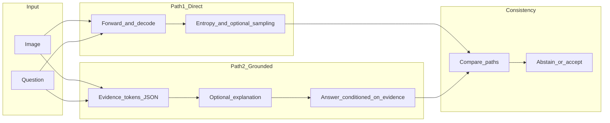

# Medical Visual Question Answering (MedVQA)

Einheitliches Framework für Training und Evaluation von **LLaVA**- und **LLaVA-Med**-Modellen auf den Medical-VQA-Datensätzen **PathVQA**, **SLAKE** und **VQA-Rad**.

Dieses Repository dient gleichzeitig als Codebasis für eine **Masterarbeit** zur **Unsicherheitskalibrierung** (selective prediction, Risk-Coverage, AURC) und zum **visuellen Grounding** über ein geplantes **Dual-Path-Inferenzsystem**: ein Pfad für direkte Antworten inkl. Unsicherheitssignalen, ein zweiter für strukturiertes, evidenzbasiertes Reasoning.

---

## Inhaltsverzeichnis

- [Kurzüberblick Masterarbeit](#kurzüberblick-masterarbeit)
- [Ist-Zustand vs. Blueprint (Roadmap)](#ist-zustand-vs-blueprint-roadmap)
- [Geplante Systemarchitektur](#geplante-systemarchitektur)
- [Repository-Layout](#repository-layout)
- [Installation & Setup](#installation--setup)
- [Schritt 1: Daten](#schritt-1-daten)
- [Schritt 2: Training (Baseline)](#schritt-2-training-baseline)
- [Schritt 3: Inferenz Path 1 (Unsicherheit)](#schritt-3-inferenz-path-1-unsicherheit)
- [Schritt 4: Inferenz Path 2 (Grounding, geplant)](#schritt-4-inferenz-path-2-grounding-geplant)
- [Schritt 5: Konsistenz & Abstain (geplant)](#schritt-5-konsistenz--abstain-geplant)
- [Schritt 6: Evaluation](#schritt-6-evaluation)
- [Schritt 7: Experimente & Ablations](#schritt-7-experimente--ablations)
- [Ergebnisse & Artefakte](#ergebnisse--artefakte)
- [Data Loader (API)](#data-loader-api)
- [Debugging & Qualitätssicherung](#debugging--qualitätssicherung)
- [Troubleshooting](#troubleshooting)

---

## Kurzüberblick Masterarbeit

**Ziele:**

- **Kalibrierung / Zuverlässigkeit:** Unsicherheitsmaß primär über tokenbasierte Entropie, selektive Vorhersage mit Schwellen \( \tau \), Kurven **Risk–Coverage** und **AURC** (Area Under the Risk–Coverage Curve).
- **Grounding:** Strukturierte **Evidence-Tokens** (z. B. Organ, Region, Merkmal; in Pathologie zusätzlich tissue type, cellular pattern, staining/morphology), optional ROI-Unterstützung (SAM, Attention, Crop/Visual Prompt), Evaluierung u. a. über **kontrafaktische** Eingaben (blank, patch-permutation, definierte ROI-Maskierung).
- **Dual-Path:** Pfad 1 (direkt) und Pfad 2 (grounded) mit **Konsistenzlogik** und **Abstain**, wenn Unsicherheit hoch und die Pfade widersprechen.

**Datensätze:** PathVQA, SLAKE, VQA-Rad, Med-VQA-2019 (siehe unten).

**Optional Stage-1 (extern):** Das Paper/Dataset **S-Chain** (*Structured Visual Chain-of-Thought*) liefert expertisch annotierte **SV-CoT**-Spuren mit Bounding Boxes (u. a. OASIS-MRI). Ein Pretraining oder eine Adapter-Stage darauf ist **inhaltlich** naheliegend, aber **domänenverschieden** zu Rad/Pathologie in den drei Zieldatensätzen; ein etwaiger Transfer ist eine **eigene empirische Fragestellung**, nicht „out of the box“ dieselbe Verteilung.

---

## Ist-Zustand vs. Blueprint (Roadmap)

| Komponente | Status im Repository |
|------------|----------------------|
| Einheitlicher Datenloader (`MedicalVQALoader`, `VQASample`) | **Implementiert** (`utils/load_data.py`) |
| Training Standard-LLaVA (HF `LlavaForConditionalGeneration` + `Trainer`) | **Implementiert** (`03_training/train.py`) |
| Training LLaVA-Med (Microsoft-`llava` + `Trainer`) | **Implementiert** (`03_training/train_med.py`, benötigt installiertes LLaVA-Med) |
| Training Qwen-VL 2.5 / 3 (HF + `Trainer`) | **Implementiert** (`03_training/train_qwen.py`, Default Qwen2.5; Qwen3 via `--model_path`) |
| Training Qwen/LLaVA + Spatial Filter | **Implementiert** (`03_training/train_qwen_modified.py`, `03_training/train_llava_modified.py`) |
| Inferenz LLaVA + Unsicherheitsmetriken (`entropy`, `agreement`, `confidence`) | **Implementiert** (`04_evaluation/inference.py`) |
| Inferenz LLaVA-Med | **Implementiert** (`04_evaluation/inference_med.py`) |
| Inferenz Qwen-VL (2.5 / 3) + Unsicherheitsmetriken | **Implementiert** (`04_evaluation/inference_qwen.py`) |
| Inferenz MedVLM-R1 (off-the-shelf, Accuracy + Agreement) | **Implementiert** (`04_evaluation/inference_medvlm_r1.py`) |
| Metriken auf Ergebnis-JSON (Accuracy-Gruppen, BLEU, ROUGE-L, BERTScore, mittlere Token-Entropie) | **Implementiert** (`04_evaluation/evaluate.py`) |
| Risk–Coverage-Sweep, AURC, Plots | **Implementiert** (`risk_coverage_entropy.py`, `plot_rcc_model_comparison.py`) |
| Selector / MLP-Workflow (LLaVA-Med-Features) | **Implementiert** (`04_evaluation/selector_multimodal.py`) |
| **5-fach Sampling + Agreement** | **Implementiert** (`04_evaluation/inference.py`, `inference_med.py`) |
| **Pfad 2: Evidence-JSON, konditionierte finale Antwort** | **Geplant** |
| **ROI-Pipeline mit Ablations-Toggle** (SAM/Attention, Crop/Overlay) | **Geplant** |
| **Dual-Path-Konsistenz & Abstain-Regeln** | **Geplant** |
| **ECE** (Binning-Kalibrierung), feste Risk-/Coverage-Ziele als eigene Pipeline | **Geplant** (AURC/Coverage-Abschnitte existieren in `risk_coverage_entropy.py`) |
| **Kontrafaktische Grounding-Eval** (blank/shuffled/ROI-masked) | **Geplant** |
| Modulstruktur `02_data/`, `06_outputs/`, `07_results/`, `utils/`, … | **Ist** (nummerierte Daten-/Output-Ordner + Paket `utils/` am Repo-Root) |

---

## Geplante Systemarchitektur

Ablauf gemäß Implementation Blueprint (Zielbild):



- **Path 1:** Standard-VQA-Generierung; Unsicherheit aus **einer** Greedy- oder Sample-Pass-Generierung (aktuell: Entropie aus `output_scores`); geplant zusätzlich **N Stichproben** (empfohlen \(N=5\) bis \(10\), mit `temperature`/`top_p`) und **Agreement** zwischen Antwortstrings als zentrale Erweiterung.
- **Path 2:** Separater Ablauf (eigener Prompt / eigene Vorwärtsläufe): strukturierte Evidence-Ausgabe, optional kurze Begründung, dann finale Antwort; **nicht** mit Path 1 vermischen, bis die Fusion in der Konsistenzschicht erfolgt.
- **ROI (optional):** Vorverarbeitung oder Visual Prompt; per Flag ein-/ausschaltbar für Ablationsstudien.

---

## Repository-Layout

**Aktuell (ausgewählt):**

| Pfad | Rolle |
|------|--------|
| `03_training/train.py` | Fine-Tuning **HuggingFace LLaVA 1.5** |
| `03_training/train_med.py` | Fine-Tuning **LLaVA-Med** (Microsoft-Codebasis) |
| `03_training/train_qwen.py` | Fine-Tuning **Qwen2.5-VL-7B** (HF) |
| `04_evaluation/inference.py` | Inferenz + Entropie (**LLaVA**) |
| `04_evaluation/inference_med.py` | Inferenz (**LLaVA-Med**) |
| `04_evaluation/inference_qwen.py` | Inferenz + Entropie (**Qwen2.5-VL**) |
| `04_evaluation/verify_pseudo_reasoning_qwen.py` | Qwen-Verify für Pseudo-Rationales (`qwen_verify`) |
| `04_evaluation/inference_medvlm_r1.py` | Inferenz (**MedVLM-R1**, pretrained) |
| `utils/qwen_vl.py` | Qwen-Input-Prep, Label-Masking, gemeinsame Hilfen |
| `utils/medvlm_r1.py` | MedVLM-R1-Prompt, `<answer>`-Parser, Qwen2-VL-Input-Prep |
| `04_evaluation/evaluate.py` | Aggregierte Metriken aus JSON |
| `04_evaluation/risk_coverage_entropy.py` | Entropie-Schwellen, Risk–Coverage, **AURC** |
| `04_evaluation/plot_rcc_model_comparison.py` | RCC: best-of-experiment oder alle Specs pro Experiment |
| `04_evaluation/selector_multimodal.py` | Feature-Extraktion, Selector-Training, Eval |
| `04_evaluation/plot_entropy.py` | Hilfen zur Entropie-Visualisierung |
| `utils/build_mc_datasets_openai.py` | MC-Export mit OpenAI-Distraktoren |
| `utils/build_pseudo_reasonings_openai.py` | Pseudo REGION/OBS/REASONING via `--model gpt-4o-mini` oder `qwen3-vl-8b` |
| `utils/download_datasets.py` | Download PathVQA / SLAKE / VQA-Rad / Med-VQA-2019 nach `02_data/` |
| `utils/example_loader_usage.py` | Beispiel Nutzung des Loaders |
| `utils/load_data.py` | `MedicalVQALoader`, `VQASample` |
| `utils/save_results.py` | JSON/CSV/XLSX unter `--results_dir` (Default `06_results/` / `MEDVQA_RESULTS_DIR`) |
| `utils/mc_eval.py` | MC-Metriken aus Inferenz-JSON → `{stem}_eval.json`; Zeile in `eval_runs_mc.csv` (Ordner des JSON; per `evaluate.py --eval_runs_csv` steuerbar) |
| `utils/prompt_formatter.py`, `utils/dataset.py` | Hilfsfunktionen |
| `02_data/` | Rohdaten + MC-Exporte (Standard `02_data/data_mc_openai/`) |
| `06_outputs/` | Checkpoints / Trainings-Artefakte (Default `--output_dir`) |
| `07_results/` | Inferenz- und Eval-Ergebnisse (Default `--results_dir`) |
| `01_external/` | z. B. LLaVA-Med-Checkout (nicht versioniert) |

**Optional (Blueprint):** spätere Paketstruktur `models/`, `uncertainty/`, `grounding/`, … – derzeit nicht als Verzeichnisse angelegt.

---

## Installation & Setup

- **Python** 3.10+ und **CUDA**-fähige GPU werden für Training und 7B-Inferenz empfohlen.
- **HuggingFace:** Erster Modell-Download braucht Netzwerkzugriff; Cache typisch unter `~/.cache/huggingface/hub/`.

### Abhängigkeiten (Kern + tatsächlich genutzte Pakete)

```bash
pip install torch transformers pillow pandas tqdm nltk wandb matplotlib numpy

# Optional: freie Text-Eval (BLEU/ROUGE/BERT) falls ihr ein entsprechendes Pipeline-Skript nutzt
pip install rouge-score bert-score

# Optional: XLSX-Export der Inferenz (utils/save_results.py)
pip install openpyxl

# Optional: Datensatz-Download (download_datasets.py)
pip install datasets huggingface_hub

# Qwen-VL (train_qwen.py, inference_qwen.py) — Qwen2.5-VL und Qwen3-VL
pip install "transformers>=4.57" qwen-vl-utils accelerate
```

Bei `KeyError: 'qwen2_5_vl'` oder fehlender `Qwen3VLForConditionalGeneration`-Klasse ggf. Transformers aus Source installieren:

```bash
pip install git+https://github.com/huggingface/transformers accelerate
pip install qwen-vl-utils
```

**NLTK** (z. B. für BLEU in freier Text-Evaluation, falls genutzt):

```python
import nltk
nltk.download("punkt")
```

**LLaVA-Med** (`03_training/train_med.py`, `04_evaluation/inference_med.py`): gemäß Kommentar in `train_med.py` das Original-Repository installieren, z. B.:

```bash
cd LLaVA-Med && pip install -e .
```

Für **`train_med.py`** mit **`model.to(torch.bfloat16)`** (siehe Skript): Vision-Tower liefert Bild-Features oft in Float32. Patchen Sie Microsofts `llava/model/llava_arch.py` in **`encode_images`** (Cast auf `mm_projector`-dtype), z. B.:

```bash
# Von medvqa/medvqa aus, LLaVA-Med unter 01_external/LLaVA-Med:
patch -d 01_external/LLaVA-Med -p1 < patches/llava_med_encode_images_projector_dtype.patch
```

(Patch liegt im Repo unter [`patches/llava_med_encode_images_projector_dtype.patch`](patches/llava_med_encode_images_projector_dtype.patch).)

---

## Schritt 1: Daten

### Erwartete Layouts (relativ zu `--data_root`, Standard: `02_data`)

Die Loader-Pfade nutzen die **kanonischen** Ordnernamen **`PathVQA`**, **`SLAKE`**, **`VQA-Rad`**, **`Med-VQA-2019`** (Groß-/Kleinschreibung wie in `utils/load_data.py`).

**PathVQA**

- `02_data/PathVQA/pathvqa_annotations/`: `pathvqa_train.csv`, `pathvqa_validation.csv`, `pathvqa_test.csv`
- `02_data/PathVQA/pathvqa_images/`: Bilder
- CSV-Spalten u. a.: `image_path`, `question`, `answer`

**SLAKE**

- `02_data/SLAKE/slake_annotations/`: `train.json`, **`validate.json`**, `test.json` (nicht `validation`)
- `02_data/SLAKE/slake_images/`: Bilder (z. B. Unterordner pro Fall)

**VQA-Rad**

- `02_data/VQA-Rad/vqarad_annotations/`: `vqarad_train.csv`, `vqarad_test.csv` (kein separates Validation-Split im Loader)
- `02_data/VQA-Rad/vqarad_images/`: Bilder

**Med-VQA-2019**

- `02_data/Med-VQA-2019/medvqa2019_annotations/`: `medvqa2019_train.csv`, `medvqa2019_validation.csv`, `medvqa2019_test.csv`
- `02_data/Med-VQA-2019/medvqa2019_images/`: Bilder
- Downloadquelle in `download_datasets.py`: HuggingFace `claudioreeves/imageclef-vqa-med-2019`

### Download

```bash
python utils/download_datasets.py
```

Voraussetzungen siehe Kopfkommentar in `download_datasets.py` (`datasets`, `huggingface_hub`, …).

---

## Schritt 2: Training (Baseline)

### Prompt- und Loss-Format (Standard-LLaVA, `03_training/train.py`)

Entspricht den Kommentaren im Code:

- **Konversation:** Nutzer-Inhalt = Bild + Text (Frage + kurze medizinische Instruction), Assistent = **nur die Antwort**.
- **Training:** Der Loss wird **nur auf den Tokens der Assistenten-Antwort** berechnet (Prompt-Teil mit `-100` maskiert).

### Standard-LLaVA trainieren

```bash
python 03_training/train.py \
  --dataset pathvqa \
  --output_dir ./06_outputs/llava_pathvqa
```

Beispiel Med-VQA-2019:

```bash
python 03_training/train.py \
  --dataset medvqa2019 \
  --output_dir ./06_outputs/llava_medvqa2019
```

Default `--model_path`: `llava-hf/llava-1.5-7b-hf`.

Fortsetzung von Checkpoint:

```bash
python 03_training/train.py \
  --model_path ./06_outputs/llava_pathvqa \
  --dataset slake \
  --output_dir ./06_outputs/llava_slake
```

Wichtige Optionen (Auszug): `--data_root`, `--train_split`, `--val_split` (bei SLAKE Validation z. B. `--val_split validate`), `--num_train_epochs`, `--per_device_train_batch_size`, `--learning_rate`, `--max_length`, `--fp16` / `--bf16`, `--gradient_checkpointing`, LoRA-Flags (`--use_lora`, …), `--wandb_project`.

**Hinweis:** HF-LLaVA läuft über `03_training/train_llava.py` (Default `llava-hf/llava-1.5-7b-hf`). **LLaVA-Med** läuft über `03_training/train_llava-med.py` (Default `microsoft/llava-med-v1.5-mistral-7b`). **Qwen-VL** (2.5 und 3) läuft über `03_training/train_qwen.py` (Default `Qwen/Qwen2.5-VL-7B-Instruct`; Qwen3 via `--model_path Qwen/Qwen3-VL-8B-Instruct`).

**Pseudo-Reasoning (LLaVA / LLaVA-Med):** gleiche JSON-Prompts wie Qwen (`utils/qwen_vl.py`). Flags: `--use_reasoning`, `--answer_first`, `--both_json_orders` (RF+AF, ≈2×), `--mc_export_suffix` (z. B. `_verify`), `--max_train_samples`. Bei Reasoning `--max_length 2048` empfohlen.

```bash
python 03_training/train_llava.py \
  --dataset vqarad \
  --mc_data_root 02_data/data_mc_openai \
  --mc_export_suffix _verify \
  --val_split test \
  --use_reasoning --answer_first \
  --max_length 2048 --bf16 --gradient_checkpointing --use_8bit_optimizer \
  --output_dir ./05_outputs/mc/llava/llava_vqarad_af

python 03_training/train_llava-med.py \
  --dataset vqarad \
  --mc_data_root 02_data/data_mc_openai \
  --mc_export_suffix _verify \
  --val_split test \
  --use_reasoning --answer_first \
  --max_length 2048 --bf16 --gradient_checkpointing --use_8bit_optimizer \
  --output_dir ./05_outputs/mc/llava-med/llava_med_vqarad_af
```

Beide JSON-Orders (RF + AF) — gleiches Flag wie bei Qwen:

```bash
python 03_training/train_llava.py \
  --dataset vqarad \
  --mc_data_root 02_data/data_mc_openai \
  --mc_export_suffix _verifyQWEN3 \
  --val_split test \
  --use_reasoning --both_json_orders \
  --max_train_samples 10000 --max_length 2048 \
  --bf16 --gradient_checkpointing --use_8bit_optimizer \
  --output_dir ./05_outputs/mc/llava/llava_vqarad_both/
```

### Qwen-VL trainieren (MC-Baseline)

Gleiches MC-Format und Loss-Masking wie LLaVA-HF; Bildverarbeitung über `qwen-vl-utils` (`utils/qwen_vl.py`, Modell-Loader in `utils/qwen_model.py`).

**SLAKE** (Validation-Split heißt `validate`):

```bash
python 03_training/train_qwen.py \
  --dataset slake \
  --val_split validate \
  --output_dir ./05_outputs/qwen_slake \
  --bf16 --gradient_checkpointing
```

**VQA-Rad** (kein `validation`-Split im Loader; Early-Stopping optional mit `--val_split test`):

```bash
python 03_training/train_qwen.py \
  --dataset vqarad \
  --output_dir ./05_outputs/qwen_vqarad \
  --bf16 --gradient_checkpointing
```

**Med-VQA-2019**:

```bash
python 03_training/train_qwen.py \
  --dataset medvqa2019 \
  --output_dir ./05_outputs/qwen_medvqa2019 \
  --bf16 --gradient_checkpointing
```

**Qwen3-VL-8B** (answer-only):

```bash
python 03_training/train_qwen.py \
  --dataset vqarad \
  --model_path Qwen/Qwen3-VL-8B-Instruct \
  --output_dir ./05_outputs/mc/qwen3/vqarad_MC_full \
  --bf16 --gradient_checkpointing
```

**Qwen3-VL-8B** mit Explanation (`--use_reasoning`; verified Pseudo-Reasoning-JSON vorausgesetzt):

```bash
python 03_training/train_qwen.py \
  --dataset vqarad \
  --model_path Qwen/Qwen3-VL-8B-Instruct \
  --use_reasoning \
  --output_dir ./05_outputs/mc/qwen3/vqarad_reasoning \
  --bf16 --gradient_checkpointing
```

Beide JSON-Orders (RF + AF) pro Sample (≈2× Trainingsbeispiele; Val bleibt answer-only / ohne Dual). Qwen2.5 und Qwen3 teilen sich `train_qwen.py` — nur `--model_path` ändern:

```bash
python 03_training/train_qwen.py \
  --dataset slake \
  --val_split validate \
  --model_path Qwen/Qwen2.5-VL-7B-Instruct \
  --mc_data_root 02_data/data_mc_openai \
  --mc_export_suffix _verifyQWEN3 \
  --use_reasoning --both_json_orders \
  --max_train_samples 10000 --max_length 2048 \
  --bf16 --use_8bit_optimizer --gradient_checkpointing \
  --output_dir ./05_outputs/mc/FINAL/withX/pseudo-reasonings_qwen3/qwen2.5/qwen2.5_slake_both/

python 03_training/train_qwen.py \
  --dataset vqarad \
  --val_split test \
  --model_path Qwen/Qwen3-VL-8B-Instruct \
  --mc_data_root 02_data/data_mc_openai \
  --mc_export_suffix _verifyQWEN3 \
  --use_reasoning --both_json_orders \
  --max_train_samples 10000 --max_length 2048 \
  --bf16 --use_8bit_optimizer --gradient_checkpointing \
  --output_dir ./05_outputs/mc/FINAL/withX/pseudo-reasonings_qwen3/qwen3/qwen3_vqarad_both/
```

Dual-Order-Eval: zwei Inference-Läufe (RF ohne `--answer_first`, AF mit) auf demselben `*_both`-Checkpoint, dann poolen:

```bash
python 04_evaluation/merge_rf_af_results.py \
  --rf 06_results/FINAL/withX/pseudo_qwen3/both/rf/vqarad/qwen2.5/qwen2.5-vl_vqarad_all.json \
  --af 06_results/FINAL/withX/pseudo_qwen3/both/af/vqarad/qwen2.5/qwen2.5-vl_vqarad_all.json \
  --output 06_results/FINAL/withX/pseudo_qwen3/both/merged/vqarad/qwen2.5/qwen2.5-vl_vqarad_all.json \
  --evaluate
```

`agreement_samples` werden konkateniert (Default 5+5=10); `agreement` / `entropy` / `confidence` neu gemittelt; `predicted_letter` = Majority über die 10 Draws.

LoRA statt Full-FT: `--use_lora` (Default-Targets: `q_proj k_proj v_proj o_proj`). Default `--output_dir`: `$MEDVQA_OUTPUTS_DIR/qwen`.

### Spatial Filter (Qwen-VL / LLaVA)

Learnable per-patch filter on visual tokens (position-aware scorer + fusion). Training scripts wrap the base model, save unwrapped weights, and write `spatial_filter.pt` next to the checkpoint. Inference auto-loads the filter when that file is present (`inference_qwen.py`, `inference_llava.py`).

**Qwen2.5 full + Spatial Filter (VQA-Rad):**

```bash
python 03_training/train_qwen_modified.py \
  --model_path Qwen/Qwen2.5-VL-7B-Instruct \
  --dataset vqarad \
  --mc_data_root 02_data/data_mc_openai \
  --val_split test \
  --bf16 --gradient_checkpointing --use_8bit_optimizer \
  --max_length 512 --num_train_epochs 5 \
  --per_device_train_batch_size 1 --gradient_accumulation_steps 1 \
  --learning_rate 2e-5 --dataloader_num_workers 1 \
  --output_dir ./05_outputs/mc/FINAL/noX/qwen/vqarad_MC_full_spatial
```

**Qwen3 LoRA + Spatial Filter (Med-VQA-2019):** same script with `--model_path Qwen/Qwen3-VL-8B-Instruct --use_lora --val_split validation` and e.g. `--output_dir ./05_outputs/mc/FINAL/noX/qwen3/medvqa2019_MC_LoRA_spatial` (LoRA is merged on save → full weights + `spatial_filter.pt`).

**LLaVA full + Spatial Filter (SLAKE):**

```bash
python 03_training/train_llava_modified.py \
  --model_path llava-hf/llava-1.5-7b-hf \
  --dataset slake \
  --mc_data_root 02_data/data_mc_openai \
  --val_split validate \
  --bf16 --gradient_checkpointing --use_8bit_optimizer \
  --max_length 512 --num_train_epochs 5 \
  --per_device_train_batch_size 1 --gradient_accumulation_steps 1 \
  --learning_rate 2e-5 --dataloader_num_workers 1 \
  --output_dir ./05_outputs/mc/FINAL/noX/llava/slake_MC_full_spatial
```

### Stufen-Strategie (Thesis / Blueprint)

1. **Grounding-Pretraining (optional, extern):** Stage auf **S-Chain**-artigem SV-CoT-Material als Grounding-Vortraining (Domain-Shift beachten).
2. **In-domain Grounding:** **SLAKE** mit oder ohne ROI (ROI: geplant), da SLAKE näher am geplanten Grounding-Setup liegt.
3. **Weak-grounding Transfer:** **VQA-Rad / PathVQA** mit derselben Pipeline als Transfer-/Robustheitsprüfung (weniger explizites Grounding als S-Chain/SLAKE).

**Optional:** Zusätzlicher Loss auf **Evidence-/Zwischentokens** (nur sinnvoll mit supervisierten oder distillierten Labels).

---

## Schritt 3: Inferenz Path 1 (Unsicherheit)

### Ablauf (Zielbild Blueprint)

1. Bild + Frage
2. Vorwärts-Generierung (greedy oder sampling)
3. \(N\) unabhängige Samples (Default: **5**) bei `temperature > 0` für Agreement-Berechnung
4. Agreement über die \(N\) decodierten Buchstaben als zusätzlicher Unsicherheits-/Stabilitätsindikator

### Ist-Zustand (`inference.py`)

- Hauptlauf mit `model.generate(..., output_scores=True)` pro Beispiel für Antwort, Entropie und Confidence.
- **Entropie (aktueller Stand):** Pro Beispiel werden `--agreement_samples` stochastische Läufe durchgeführt; `entropy` ist der Mittelwert der laufweisen Entropie-Mittelwerte. `entropy_tokens` bleibt als tokenweise Entropie aus dem Hauptlauf gespeichert.
- **Wichtige Präzisierung:** Diese Aggregation ist methodisch nur eine Übergangslösung. Zieldefinition ist token-distributionsbasiert über **alle** generierten Positionen ohne Unique-Filter, z. B. \(H = -\sum_t p(y_t)\log p(y_t)\) bzw. eine äquivalente positionsweise Aggregation.
- **Agreement-Sampling:** Zusätzlich werden standardmäßig `--agreement_samples 5` stochastische Läufe ausgeführt (mit `temperature`/`top_p`) und als Mehrheitsanteil aggregiert.
- **Confidence:** `confidence` wird als Mittelwert der laufweisen Top-1-Tokenwahrscheinlichkeiten über alle Agreement-Samples gespeichert.

### Aufruf (Beispiele)

```bash
python 04_evaluation/inference.py \
  --dataset pathvqa \
  --split test \
  --results_dir 07_results
```

Mit fine-getunten Gewichten (Weg zum Checkpoint anpassen):

```bash
python 04_evaluation/inference.py \
  --model_path ./06_outputs/llava_pathvqa \
  --dataset pathvqa \
  --split test \
  --finetuned \
  --results_dir 07_results
```

Stichprobige Decodierung (für spätere Sampling-Erweiterungen relevant):

```bash
python 04_evaluation/inference.py \
  --dataset slake \
  --split test \
  --do_sample \
  --temperature 0.7 \
  --top_p 0.9 \
  --results_dir 07_results
```

Med-VQA-2019 (Test-Split):

```bash
python 04_evaluation/inference.py \
  --dataset medvqa2019 \
  --split test \
  --results_dir 07_results
```

Weitere Flags: `--data_root`, `--max_new_tokens`, `--reasoning_max_new_tokens`, `--num_beams`, `--agreement_samples`, `--use_two_stage_reasoning`, `--use_gradcam`, `--gradcam_dir`, `--gradcam_chunk_size`, `--ablation_mode`, `--ablation_seed`, `--n_samples` (nur erste \(N\) Datensatzzeilen), W&B (`--wandb_project`, `--wandb_run_name`).

### Optional: 2-stufiges Reasoning (`inference.py`, `inference_med.py`)

Mit `--use_two_stage_reasoning` läuft die Inferenz in zwei Schritten:

1. **Reasoning-Phase**: Bild + Frage, Ausgabe im Format `REGION/OBSERVATION/REASONING`.
2. **Finale MC-Phase**: Zweiter Prompt mit den extrahierten Feldern und Ausgabe nur als Optionsbuchstabe.

Die Stage-1-Ausgabe wird marker-frei best-effort geparst (fehlende Felder werden als `unknown` gesetzt und Schritt 2 wird trotzdem ausgeführt).
Im 2-Stage-Modus wird Schritt 2 strikt über die **Option-Logits des ersten Antworttokens** decodiert (`stage2_decoding_mode = letter_logits_only`), um Freitext-Drift wie `\"C, D\"` zu vermeiden.

Optional: Mit `--use_gradcam` (nur zusammen mit `--use_two_stage_reasoning`) wird aus den **Stage-1-Reasoning-Tokens** eine GradCAM-Heatmap berechnet und ein Overlay-Bild für Stage 2 verwendet. Artefakte werden unter `--gradcam_dir` gespeichert (Default: `<results_dir>/gradcam_overlays`). Für `inference.py` wird aktuell ein kontrollierter Fallback dokumentiert (`gradcam_status=failed`, `gradcam_error=unsupported_backend`).
Wenn `--use_gradcam` aktiv ist, wird die Inferenz automatisch in Chunks verarbeitet (Default `--gradcam_chunk_size 100`, Restchunk inklusive), um OOM-Risiko bei langen Läufen zu reduzieren.

Wichtig: `--reasoning_max_new_tokens` steuert nur Schritt 1 (Reasoning, Default `192`), während `--max_new_tokens` weiterhin für die finale MC-Antwort gilt.

Beispiel (`inference.py`):

```bash
python 04_evaluation/inference.py \
  --dataset vqarad \
  --split test \
  --use_two_stage_reasoning \
  --use_gradcam \
  --results_dir 07_results
```

Beispiel (`inference_med.py`):

```bash
python 04_evaluation/inference_med.py \
  --dataset vqarad \
  --split test \
  --use_two_stage_reasoning \
  --use_gradcam \
  --results_dir 07_results
```

### Counterfactual Ablation-Modi (`inference_qwen.py`, `inference_llava.py`, `inference_llava-med.py`)

Für kontrollierte Gegenfaktual-Tests kann ein globaler Ablationsmodus gesetzt werden:

- `--ablation_mode none`: Standard, Originalbild pro Sample
- `--ablation_mode black`: Bild wird vollständig geschwärzt (gleiche Auflösung)
- `--ablation_mode shuffle`: Bildzuordnung wird pro Run zufällig zwischen Samples permutiert (Frage/GT bleiben beim Originalsample)
- `--ablation_mode crop_unsupervised`: FGR Winning Crop aus `overall_winner_unsupervised_crop`
- `--ablation_mode crop_supervised`: FGR Winning Crop aus `overall_winner_supervised_crop`

Optional steuert `--ablation_seed` die reproduzierbare Permutation im `shuffle`-Modus.

Für `crop_unsupervised` / `crop_supervised` zusätzlich:

- `--fgr_region_comparison_json` (Pfad zur JSON von `fgr_region_comparison.py`, z. B. `fgr_region_comparison_vqarad_10.json`)
- Samples **ohne** Mapping in der JSON werden **übersprungen** (Log: `Skipped N samples ...`)

Beispiel (`black`):

```bash
python 04_evaluation/inference_llava-med.py \
  --dataset vqarad \
  --split test \
  --ablation_mode black \
  --results_dir 07_results
```

Beispiel (`shuffle`):

```bash
python 04_evaluation/inference_llava.py \
  --dataset vqarad \
  --split test \
  --ablation_mode shuffle \
  --ablation_seed 42 \
  --results_dir 07_results
```

Beispiel (`crop_unsupervised` mit Qwen):

```bash
PYTHONPATH=. python 04_evaluation/inference_qwen.py \
  --dataset vqarad \
  --split test \
  --n_samples 10 \
  --ablation_mode crop_unsupervised \
  --fgr_region_comparison_json fgr_region_comparison_vqarad_10.json \
  --disable_wandb
```

Beispiel (`crop_supervised`):

```bash
PYTHONPATH=. python 04_evaluation/inference_qwen.py \
  --dataset vqarad \
  --split test \
  --n_samples 10 \
  --ablation_mode crop_supervised \
  --fgr_region_comparison_json fgr_region_comparison_vqarad_10.json \
  --disable_wandb
```

### Ausgabe-Dateien

`utils/save_results.save_results` schreibt unter `--results_dir` u. a.:

- **`{modell_kurz}_{dataset}_{n_tag}.json`** – Liste von Dicts pro Sample
- Dieselbe Basis für `.csv` und optional `.xlsx`
- **`{modell_kurz}_{dataset}_{n_tag}_eval.json`** – MC-Kennzahlen (Accuracy, Entropie, Agreement, Confidence nach closed/open/overall), **automatisch** am Ende von `inference.py` und `inference_med.py` nach dem Speichern des Haupt-JSONs
- **`eval_runs_mc.csv`** – gleicher Ordner wie die Ergebnis-JSONs: eine Zeile pro Eval-Lauf (wie früher `evaluate.py` → `eval_runs.csv`, Spalten `yesno_*` / `open_*` / `overall_*`). Manuell: `evaluate.py --eval_runs_csv /pfad/zur/zentralen.csv` überschreibt das.

`n_tag` ist `all`, wenn `--n_samples` nicht gesetzt ist.

### JSON-Felder pro Sample (mindestens)

- `image_path`, `source_image_path`, `ablation_mode`, `question`, `ground_truth_answer`, `predicted_answer`
- bei `crop_unsupervised` / `crop_supervised`: zusätzlich `fgr_crop_path` (effektives Crop-Bild; `image_path` ist gleich gesetzt)
- `entropy`, `entropy_tokens`, `agreement`, `agreement_samples`, `confidence`
- **Qwen:** `entropy` und `confidence` sind Mittel über `--agreement_samples` (Default 5) stochastische Läufe; `predicted_answer` / `predicted_letter` kommen vom greedy Hauptlauf. Zusätzlich `entropy_samples` (K Einzelwerte pro Zeile).
- **Qwen** mit `--use_reasoning_json`: `use_reasoning_json`, `predicted_reasoning_text`, `predicted_json_parse_ok`, `entropy_tokens_all` (tokenweise Entropy über die gesamte JSON-Generierung des greedy Hauptlaufs), `entropy_sequence_mean` (Mittel darüber) zusätzlich zu `predicted_answer` / `predicted_letter`. Scalar `entropy` bleibt Antwort-Token-Entropy, Mean über K Agreement-Samples.
- optional 2-stage Felder: `reasoning_raw`, `reasoning_region`, `reasoning_observation`, `reasoning_explanation`, `reasoning_parse_mode` (`best_effort`)
- optionale Strict-Decoding-Felder: `stage2_decoding_mode`, `stage2_option_probs`
- optionale GradCAM-Felder: `use_gradcam`, `gradcam_status`, `gradcam_error`, `gradcam_overlay_path`, `gradcam_heatmap_path`
- nach Inferenz ergänzt: `bleu_1` … `bleu_4`, `rougeL`, `bert_f1` (und weitere ROUGE-Keys je nach Version)

Das alte README-Beispiel mit `full_response` und `<question>`-Tokens ist **veraltet**; das tatsächliche Format folgt dem Chat-Template des Processors und den Feldern oben.

**LLaVA / LLaVA-Med:** `inference_llava.py` / `inference_llava-med.py`. Mit **`--use_reasoning_json`** (optional **`--answer_first`**) derselbe JSON-Contract wie beim Training (`train_llava*.py --use_reasoning`); Default `--max_new_tokens` dann 320. Nicht zusammen mit `--use_two_stage_reasoning` verwendbar. Zusätzliche Result-Felder: `predicted_reasoning_text`, `predicted_json_parse_ok`.

```bash
python 04_evaluation/inference_llava.py \
  --dataset vqarad --split test \
  --model_path ./05_outputs/mc/llava/llava_vqarad_af \
  --finetuned --use_reasoning_json --answer_first \
  --max_new_tokens 512 --results_dir 06_results

python 04_evaluation/inference_llava-med.py \
  --dataset vqarad --split test \
  --model_path ./05_outputs/mc/llava-med/llava_med_vqarad_af \
  --finetuned --use_reasoning_json --answer_first \
  --max_new_tokens 512 --results_dir 06_results
```

**Qwen-VL:** `inference_qwen.py` — MC-Inferenz mit Entropie, Agreement, Confidence und Ablationen (`black`/`shuffle`); **ohne** 2-Stage-Reasoning und GradCAM. Unterstützt Qwen2.5-VL und Qwen3-VL via `--model_path`.

**Unsicherheit (Qwen):** `--agreement_samples K` (Default 5) steuert `agreement`, `confidence` und scalar `entropy` gemeinsam — letztere beiden sind arithmetische Mittel über K stochastische Generierungen (`temperature`/`top_p`). Answer-only: Token-Entropy am ersten generierten Token; mit `--use_reasoning_json`: scalar `entropy` am Antwort-Buchstaben-Token im JSON. Der greedy Hauptlauf liefert `predicted_*`; mit `--use_reasoning_json` zusätzlich `entropy_tokens_all` (Entropy pro generiertem Token der JSON-Antwort) und `entropy_sequence_mean`.

Mit **`--use_reasoning_json`** erfolgt denselben **JSON-Assistenz-Contract** wie bei `train_qwen.py --use_reasoning`: Antwort nur als `{\"reasoning\":\"...\",\"answer\":\"<Buchstabe>\"}` (siehe `utils/qwen_vl.py` → `MC_JSON_RESPONSE_INSTRUCTION`). **`--max_new_tokens`** sollte erhöht bleiben (Default bei gesetztem Flag: 320); manuell setzbar wenn längere Reasonings erwartet werden. Pro Zeile zusätzliche Felder: `predicted_reasoning_text`, `predicted_json_parse_ok`, sowie `predicted_answer` (Rohtext).

Beispiel (fine-getunt, SLAKE Test):

```bash
python 04_evaluation/inference_qwen.py \
  --dataset slake \
  --split test \
  --model_path ./05_outputs/qwen_slake \
  --finetuned \
  --results_dir 06_results
```

Reasoning‑JSON‑Checkpoint wie bei Training mit Pseudorationalen (`train_qwen.py --use_reasoning`):

```bash
python 04_evaluation/inference_qwen.py \
  --dataset slake \
  --split test \
  --model_path ./05_outputs/qwen_slake_reasoning \
  --finetuned \
  --use_reasoning_json \
  --results_dir 06_results
```

Basis-Modell (ohne Fine-Tuning): `--model_path Qwen/Qwen2.5-VL-7B-Instruct` oder `Qwen/Qwen3-VL-8B-Instruct` weglassen bzw. explizit setzen (ohne `--finetuned`).

**Qwen3-VL-8B** (pretrained, answer-only):

```bash
python 04_evaluation/inference_qwen.py \
  --dataset vqarad \
  --split test \
  --model_path Qwen/Qwen3-VL-8B-Instruct \
  --dtype bfloat16 \
  --results_dir 06_results/qwen3_base
```

**Qwen3-VL-8B** mit Explanation (Reasoning-Checkpoint):

```bash
python 04_evaluation/inference_qwen.py \
  --dataset vqarad \
  --split test \
  --model_path ./05_outputs/mc/qwen3/vqarad_reasoning \
  --finetuned \
  --use_reasoning_json \
  --dtype bfloat16 \
  --results_dir 06_results/qwen3_reasoning
```

### MedVLM-R1 (off-the-shelf)

**MedVLM-R1** ([`JZPeterPan/MedVLM-R1`](https://huggingface.co/JZPeterPan/MedVLM-R1)) ist ein **Qwen2-VL-2B**-Modell mit GRPO-Reasoning (strukturierte Ausgabe mit Reasoning- und `<answer>`-Tags). Es läuft über `inference_medvlm_r1.py` mit dem **gleichen** `MedicalVQALoader` und MC-Test-Splits wie Qwen/LLaVA.

- **Env:** eigenes Conda-Env `medvlm_r1` empfohlen (nicht `llava_med_env` / nicht `medvqa_hf` für Qwen2.5); z. B. `transformers==4.51.3`, `qwen-vl-utils`, `accelerate`, optional `flash-attn`
- **Metriken:** MC-Accuracy (greedy); optional **Agreement** mit `--do_sample --agreement_samples N`; `entropy` / `confidence` sind `NaN`
- **Default:** nur **greedy** (kein extra Sampling) — deutlich schneller
- **Hinweis:** Checkpoint ist **pretrained** (Huatuo/MRI-RL), nicht auf euren Train-Splits fine-getunt

Smoke-Test (20 Samples, greedy + Flash Attention):

```bash
conda activate medvlm_r1
python 04_evaluation/inference_medvlm_r1.py \
  --dataset slake --split test \
  --model_path JZPeterPan/MedVLM-R1 \
  --attn_implementation flash_attention_2 \
  --n_samples 20 \
  --disable_wandb
```

Optional Agreement (5× stochastische Läufe zusätzlich):

```bash
python 04_evaluation/inference_medvlm_r1.py \
  --dataset slake --split test \
  --do_sample --agreement_samples 5 \
  --attn_implementation flash_attention_2
```

Voller Test-Lauf für alle drei Datensätze:

```bash
CUDA_VISIBLE_DEVICES=0 ./scripts/run_medvlm_r1_eval.sh full
```

(Alternativ: `./scripts/run_medvlm_r1_eval.sh smoke` für je 20 Samples.)

Ergebnisse: `06_results/medvlm-r1_{dataset}_all.json` (+ `{stem}_eval.json`). Bei Masken-Längen-Fehlern: `--no_kv_cache` oder `--attn_implementation eager`.

### MedSAM-ROI-Varianten (Overlay/Crop) für direkten Vergleich

Für den schnellen Vergleich **Originalbild vs. ROI-Bild** (ohne Trainingsänderung) kann `generate_medsam_roi_variants.py` genutzt werden.

Voraussetzung: installierte SAM/MedSAM-Abhängigkeiten (u. a. `segment_anything`) und ein passender Checkpoint (`--sam_checkpoint`).

Smoke-Test auf kleinen Teilmengen:

```bash
python generate_medsam_roi_variants.py \
  --data_root 02_data \
  --datasets pathvqa vqarad \
  --splits test \
  --variants overlay crop \
  --sam_checkpoint /path/to/medsam_vit_b.pth \
  --sam_model_type vit_b \
  --output_root 02_data/data_roi \
  --save_index_json \
  --n_samples 50
```

Voller Lauf für beide Test-Splits:

```bash
python generate_medsam_roi_variants.py \
  --data_root 02_data \
  --datasets pathvqa vqarad \
  --splits test \
  --variants overlay crop \
  --sam_checkpoint /path/to/medsam_vit_b.pth \
  --sam_model_type vit_b \
  --output_root 02_data/data_roi \
  --crop_margin_ratio 0.10 \
  --overlay_alpha 0.35 \
  --save_index_json
```

Ergebnisse liegen unter `02_data/data_roi/{dataset}/{split}/{variant}/...`, plus Index-Dateien in `02_data/data_roi/index/` (inkl. `bbox_xyxy`, `mask_area_ratio`, `variant_paths`, Status).

### Minimalmodus: Question-Guided Ranked ROI (VQA-Rad, Overlay)

Für einen schnellen Test des question-guided Rankings (Regelparser + Ranking über `predicted_iou`, Flächenprior, Zentrumsprior):

```bash
python generate_medsam_roi_variants.py \
  --data_root 02_data \
  --datasets vqarad \
  --splits test \
  --variants overlay \
  --sam_checkpoint /path/to/sam_vit_b_01ec64.pth \
  --sam_model_type vit_b \
  --output_root 02_data/data_roi \
  --save_index_json \
  --max_rois 50 \
  --min_mask_area_ratio 0.0 \
  --n_samples 50
```

Empfohlene Smoke-Validierung:

- `successful` klar höher als im Auto-Baseline-Lauf.
- In `data_roi/index/vqarad_test_roi_index.json` sind pro Sample zusätzlich `roi_rank_score`, `roi_ranking_components`, `guidance_mode` gesetzt.
- Stichprobe von Overlays zeigt weniger reine Rand-/Noise-Masken.

---

## Schritt 4: Inferenz Path 2 (Grounding, geplant)

**Spezifikation (Blueprint):**

1. Prompt zur Extraktion von **Evidence** im strukturierten Format, z. B. JSON-ähnlich: `{ "organ": "...", "region": "...", "feature": "...", "tissue_type": "...", "cellular_pattern": "...", "staining_or_morphology": "..." }` (konkrete Schlüssel und Pflichtfelder in der Arbeit festlegen; radiologie- und pathologie-tauglich halten).
2. Optional: kurze textliche Erklärung (nur Analyse oder auch Eingabe für Schritt 3).
3. Finale Antwort **bedingt** auf die Evidence-Tokens (separater Generate-Lauf).
4. Alle Artefakte **getrennt** von Path 1 speichern (eigene JSON-Spalten oder eigenes File-Set).

**ROI (optional, Ablations-Toggle):**

- Quelle: z. B. SAM / MedSAM / Attention-Maps → Bounding Boxes oder Masken.
- Einspielung: Crop, zusätzliches Bild, oder **Visual Prompt** (Box-Overlay im Sinne von S-Chain-Diskussionen zu „visual prompting“).
- In Experimenten: **mit ROI / ohne ROI** vergleichen.
- **Wichtiger Hinweis:** Pseudo-ROIs sind potentiell verrauscht und können Performance verschlechtern; Effekt immer mit Ablationen validieren.

### Vokabular: lokalisierbare Tokens (Reasoning / NER-Vorbereitung)

Skript [`build_vocab_localizable_openai.py`](build_vocab_localizable_openai.py): eindeutiges **Trainings**-Vokabular aus **SLAKE + VQA-Rad + Med-VQA-2019** (Freitext über `MedicalVQALoader(..., mc_data_root=None)`), englische **Stopwords** (NLTK mit Fallback; optional `--extra_stopwords_file`), danach **OpenAI**-Batch-Klassifikation, ob ein Token in typischen medizinischen Bildern **visuell lokalisierbar** ist. Artefakte: `vocab_localizable_train.json`, `vocab_localizable_train.csv`, Cache `openai_localizable_cache.jsonl` unter `--output_dir` (Default `07_results/reasoning_vocab/`).

Abhängigkeiten: `pip install openai python-dotenv nltk` (NLTK lädt `stopwords` bei Bedarf nach).

```bash
export OPENAI_API_KEY="..."
python build_vocab_localizable_openai.py \
  --data_root 02_data \
  --output_dir 07_results/reasoning_vocab \
  --batch_size 30 \
  --resume

# Kurztest ohne volles Vokabular:
python build_vocab_localizable_openai.py --data_root 02_data --n_tokens 50
```

---

## Schritt 5: Konsistenz & Abstain (geplant)

**Richtlinien aus dem Blueprint:**

- **Pfad 1** und **Pfad 2** final vergleichen (normalisierte Strings oder semantische Ähnlichkeit – in der Arbeit definieren).
- **Widerspruch** und **hohe Unsicherheit** (Path 1) → **Abstain** (keine feste Antwort oder explizites „reject“).
- **Übereinstimmung** und **niedrige Unsicherheit** → Antwort **akzeptieren** (welcher Pfad „offiziell“ ausgegeben wird: z. B. Path 1 oder Path 2 oder Union-Regel – festlegen).

Beispielhafte Konsistenzregel:

```python
if match(path1_answer, path2_answer) and confidence > tau:
    decision = "accept"
elif (not match(path1_answer, path2_answer)) and confidence < tau_high:
    decision = "abstain"
else:
    decision = "fallback_path1"
```

Kein zusätzlicher harter Trainingsconstraint nötig; Fusion primär **inferenzzeitlich**.

**Offene Designparameter:** Schwellen für „hoch/niedrig“ (global, pro Datensatz, oder kalibriert auf Validierung); Match-Definition (normalisierter String-Match vs. semantischer Match); Definition der Unsicherheit/Konfidenz (nur Entropie vs. kombiniert mit Agreement).

---

## Schritt 6: Evaluation

### Standard-Metriken (`evaluate.py`)

```bash
python 04_evaluation/evaluate.py \
  --results_file 06_results/llava-med_pathvqa_all.json
# schreibt standardmäßig 06_results/llava-med_pathvqa_all_eval.json
# optional: --output_file /pfad/zu/metrics.json
# optional: --eval_runs_csv 06_results/results_mc/eval_runs_mc.csv  (sonst: gleicher Ordner wie die JSON)
```

MC-Kennzahlen: Accuracy (closed/open/overall über Buchstaben), Mittelwerte von **Entropie**, **agreement** und **confidence** aus den Inferenzzeilen. Normalerweise entfällt ein separater Aufruf: `inference.py` / `inference_med.py` erzeugen `{stem}_eval.json` automatisch.

### Risk–Coverage & AURC (`risk_coverage_entropy.py`)

Erwartet eine **JSON-Liste** wie von `inference.py`, mit numerischem Score-Feld für Schwellenbildung (`entropy`, `agreement` oder `confidence`) und Ground Truth für die gewählte Risk-Metrik.

```bash
python 04_evaluation/risk_coverage_entropy.py \
  --results_file 07_results/llava_pathvqa_all.json \
  --output_dir 07_results \
  --score_field entropy \
  --risk_metric match \
  --num_thresholds 200
```

- **`--risk_metric`:** `match` (1 − Exact Match pro Zeile), oder `bleu1`, `bleu4`, `rouge`, `bertscore` (nutzt gespeicherte Felder pro Sample).
- **`--score_field`:** `entropy` (niedriger = sicherer), `agreement` oder `confidence` (höher = sicherer).
- **Ein Lauf** wertet automatisch `closed`, `open` und `overall` aus.
- Ausgaben pro Typ: `*_closed_risk_coverage.csv`, `*_open_risk_coverage.csv`, `*_risk_coverage.csv` (overall) sowie passende PNG-Kurven.
- Kombinierte Summary: `{stem}_risk_coverage_summary.json` mit nested `closed` / `open` / `overall` (jeweils **AURC**, Coverage bei Ziel-Risk, Risk bei Ziel-Coverage).
- Terminal: kompakte **AURC-Tabelle** in der Reihenfolge `closed | open | overall`.

**Logik:** Bei `entropy` werden Samples mit **kleiner/gleich Schwelle** beantwortet; bei `agreement`/`confidence` mit **größer/gleich Schwelle**.

### RCC-Modellvergleich (`plot_rcc_model_comparison.py`)

Vergleicht pro Datensatz und Fragetyp die Risk–Coverage-Kurven der gewählten Runs: **noX**, **bestes zeroshot**, **bestes pseudo-SFT**. Pro Modell zwei Kurven in **derselben Farbe** (durchgezogen = entropy, gestrichelt = combined).

1. Pfade in [`configs/rcc_model_compare.json`](configs/rcc_model_compare.json) setzen (beste Runs manuell wählen, z. B. nach `overall.aurc_combined` / Accuracy in `*_eval.json`; bei both/pseudo die **merged** JSON).
2. Ausführen:

```bash
python 04_evaluation/plot_rcc_model_comparison.py \
  --config configs/rcc_model_compare.json
# optional: --datasets slake vqarad --output_dir 06_results/FINAL/rcc_compare
```

Ausgaben unter `output_dir` (Default `06_results/FINAL/rcc_compare`): `{dataset}_{closed|open|all}.pdf` (ohne Titel/Legende), `rcc_model_compare_meta.json` (Labels, Farben, Linienstil, AURC für Captions), `rcc_model_compare_aurc.csv`, `rcc_model_compare_summary.json`. Nutzt dieselbe Dual-AURC-Logik wie `risk_coverage_entropy.py` (`combined_alpha` aus Config, Default 0.5).

**Alle Specs pro Experiment** (Answer-only / Zeroshot / Pseudo-SFT): Config [`configs/rcc_experiment_specs.json`](configs/rcc_experiment_specs.json) — eine Figur je Experiment × Datensatz × Fragetyp, alle gelisteten Modell-/Order-Kombinationen (fehlende Result-JSONs werden übersprungen). Farbe = Spec, durchgezogen = entropy, gestrichelt = combined.

```bash
python 04_evaluation/plot_rcc_model_comparison.py \
  --config configs/rcc_experiment_specs.json
# optional: --experiments zeroshot --datasets vqarad
```

Ausgaben unter `06_results/FINAL/rcc_experiment_specs/{answer_only|zeroshot|pseudo_sft}/`. Templates in der Config bei Bedarf an eure echten Dateinamen anpassen.

### Geplant: ECE & erweiterte Kalibrierung

- **ECE:** z. B. Zuverlässigkeitsdiagramm für eine aus Path 1 abgeleitete **Konfidenz** (Binning) gegen empirische Genauigkeit – derzeit **nicht** im Repo; dokumentieren als geplante Erweiterung neben AURC.

### Geplant: Grounding-Eval

Kontrafaktische Varianten derselben Frage:

- **Blank / Konstantbild**
- **Shuffled:** explizite **Patch-Permutation** (fixe Patchgröße und Permutationsschema pro Experiment dokumentieren)
- **ROI-maskiert:** explizit als **Zero-Mask**, **Blur-Mask** oder **Inpainting** definieren und konsistent verwenden

Metriken: Abfall von **Accuracy** und von **Konfidenz/Entropie** relativ zum Originalbild.

---

## Schritt 7: Experimente & Ablations

Empfohlene Matrix (aus Blueprint, an die Arbeit anpassen):

| Setting | Beschreibung |
|---------|----------------|
| Baseline | Ein Pfad, greedy oder festes Decoding, ohne ROI |
| + Evidence Tokens | Path 2 oder train-time Supervision auf Evidence |
| + Pseudo-ROI | ROI aus SAM/Attention vs. ohne ROI |
| + Dual Path | Path 1 + Path 2 + Fusion |
| + Agreement-based uncertainty | \(N\) Samples, Agreement + Entropie |
| + Counterfactual training | optional Training mit kontrafaktischen Paaren |

Für jede Zeile: gleiche Test-Splits, gespeicherte JSONs mit Scores, AURC/Vergleich der Kurven, qualitative Grounding-Beispiele.

Terminologie (für die Arbeit konsistent halten):
- **uncertainty** = Entropie-basiertes Unsicherheitsmaß
- **confidence** = kombinierter Score (z. B. aus Agreement + Entropie)

---

## Ergebnisse & Artefakte

- **Checkpoints:** `--output_dir` aus `03_training/train.py` / `03_training/train_med.py` (Standard unter `06_outputs/`)
- **Inferenz:** unter `--results_dir` (Default `06_results/`): `*.json`, `*_eval.json`, `eval_runs_mc.csv`, `.csv`, optional `.xlsx`
- **Eval (manuell):** `evaluate.py` wie oben, falls ihr nur nachträglich metrisieren wollt
- **Selektive Vorhersage:** `risk_coverage_entropy.py`-Outputs (CSV/PNG pro Typ, kombinierte Summary-JSON, AURC-Tabelle)
- **Thesis:** Kurven, Tabellen, ausgewählte Fehlerfälle und Grounding-Visualisierungen

---

## Data Loader (API)

```python
from utils.load_data import MedicalVQALoader

# Nutzt MEDVQA_* / Fallbacks aus utils.paths
loader = MedicalVQALoader()
samples = loader.load_dataset("pathvqa", split="train")
samples_slake = loader.load_dataset("slake", split="validate")
samples_rad = loader.load_dataset("vqarad", split="test")
samples_medvqa = loader.load_dataset("medvqa2019", split="test")

print(loader.get_available_datasets())
print(loader.get_available_splits("slake"))  # u. a. validate
```

Jedes Element ist ein **`VQASample`:** `dataset`, `split`, `image_path`, `question`, `answer` (bei MC: Zielbuchstabe), `metadata`, `mc_options`, `mc_correct_index`, `question_type`.

`loader.load_combined("train")` kombiniert PathVQA, SLAKE, VQA-Rad und Med-VQA-2019.

### Pfade auf dem Cluster (`MEDVQA_*`)

Ohne gesetzte Variablen nutzen Loader und Skripte die **Fallbacks** aus [`utils/paths.py`](utils/paths.py) (`02_data`, `02_data/data_mc_openai`, `06_outputs`, `07_results`). Auf dem HPC kannst du statt langer `--data_root`-Ketten Folgendes setzen (Beispielpfade anpassen):

```bash
export MEDVQA_DATA_ROOT=/pfad/zum/repo/02_data
export MEDVQA_MC_ROOT=/pfad/zum/repo/02_data/data_mc_openai
export MEDVQA_OUTPUTS_DIR=/pfad/zum/repo/05_outputs
export MEDVQA_RESULTS_DIR=/pfad/zum/repo/06_results
```

Danach reicht z. B. `MedicalVQALoader()` ohne Argumente oder `python 03_training/train_med.py ...` mit den neuen Defaults.

---

## Multiple-Choice-Datensätze mit OpenAI

Mit `utils/build_mc_datasets_openai.py` können MC-Varianten für `pathvqa`, `slake`, `vqarad`, `medvqa2019` erzeugt werden. Das Skript liest **immer die Freitext-Annotations** unter `--data_root` (`MedicalVQALoader(..., mc_data_root=None)`); es braucht **keine** vorgefertigten MC-Dateien. Die Ausgabe liegt unter `--output_root` (Standard `02_data/data_mc_openai`).

- **Closed/Yes-No** (`answer` = `yes` oder `no`): Optionen strikt `["yes", "no"]`
- **Open**: 4 via OpenAI generierte falsche Optionen + GT (insgesamt 5)
- Neues Feld pro Sample: `question_type` (`closed` oder `open`)

Voraussetzung:

```bash
pip install openai
export OPENAI_API_KEY="..."
```

Smoke-Test:

```bash
python utils/build_mc_datasets_openai.py \
  --data_root 02_data \
  --output_root 02_data/data_mc_openai \
  --datasets pathvqa slake vqarad medvqa2019 \
  --openai_model gpt-4o-mini \
  --n_samples 100 \
  --save_every 20
```

Fortsetzbarer Lauf (Resume):

```bash
python utils/build_mc_datasets_openai.py \
  --data_root 02_data \
  --output_root 02_data/data_mc_openai \
  --datasets pathvqa slake vqarad medvqa2019 \
  --openai_model gpt-4o-mini \
  --resume
```

### Pseudo-Reasoning (OpenAI / Qwen3 → Qwen-Verify → Training)

Pipeline für **Pseudo-Rationales** auf MC-Trainingsdaten:

1. **Generieren** (`utils/build_pseudo_reasonings_openai.py`) — via `--model gpt-4o-mini` (OpenAI Vision) oder `--model qwen3-vl-8b` (lokal `Qwen/Qwen3-VL-8B-Instruct`) REGION/OBSERVATION/REASONING mit Gold-Antwort im Prompt; Ausgabe z. B. `*_mc_openai_pseudo.json` (Default-Suffix `_pseudo`).
2. **Qwen-Verify** (`04_evaluation/verify_pseudo_reasoning_qwen.py`) — Pretrained **Qwen2.5-VL** bekommt den Reasoning-Text + MC-Frage/Optionen **ohne Bild** (Hinweis im Prompt: die Beschreibung bezieht sich auf ein nicht gezeigtes Bild); setzt `qwen_verify` true/false. Ausgabe z. B. `*_mc_openai_pseudo_pr_qwen_verify.json`.
3. **Training** — `train_qwen.py`, `train_llava.py` oder `train_llava-med.py` mit `--use_reasoning`: nutzt nur Zeilen mit `qwen_verify=True` (oder Alias `is_correct=True`) und nicht-leerem `pseudo_reasoning_raw`. Gleiche JSON-Prompts (`utils/qwen_vl.py`).

```bash
# 1) Pseudo-Rationales generieren (OpenAI)
PYTHONPATH=. python utils/build_pseudo_reasonings_openai.py \
  --data_root 02_data \
  --mc_data_root 02_data/data_mc_openai \
  --datasets vqarad \
  --model gpt-4o-mini \
  --n_reasonings 5 --temperature 0.7

# 1b) alternativ mit lokalem Qwen3-VL-8B
PYTHONPATH=. python utils/build_pseudo_reasonings_openai.py \
  --data_root 02_data \
  --mc_data_root 02_data/data_mc_openai \
  --datasets vqarad \
  --model qwen3-vl-8b \
  --dtype bfloat16 \
  --n_reasonings 5 --temperature 0.7

# 2) Mit Basis-Qwen verifizieren (empfohlen: Pretrained, nicht das später fine-getunte Reasoning-Modell)
python 04_evaluation/verify_pseudo_reasoning_qwen.py \
  --input_json 02_data/data_mc_openai/vqarad/vqarad_train_mc_openai_pseudo.json \
  --model_path Qwen/Qwen2.5-VL-7B-Instruct \
  --resume

# 3) Reasoning-Training (Qwen, LLaVA oder LLaVA-Med)
python 03_training/train_qwen.py \
  --dataset vqarad \
  --use_reasoning \
  --use_lora \
  --output_dir ./05_outputs/qwen_vqarad_reasoning \
  --bf16 --gradient_checkpointing

python 03_training/train_llava.py \
  --dataset vqarad --mc_export_suffix _verify \
  --use_reasoning --answer_first --max_length 2048 \
  --output_dir ./05_outputs/mc/llava/llava_vqarad_af \
  --bf16 --gradient_checkpointing
```

Inferenz auf dem Reasoning-Checkpoint: `inference_qwen.py` / `inference_llava.py` / `inference_llava-med.py` mit `--use_reasoning_json` (und `--answer_first` falls so trainiert); `--max_new_tokens 512` empfohlen.

Die **2-Stufen-Inferenz** (`--use_two_stage_reasoning`) in `inference_llava-med.py` / `inference_llava.py` nutzt weiterhin [`utils/reasoning_mc.py`](utils/reasoning_mc.py) für Prompt/Parser (unabhängig von dieser Pseudo-Pipeline).

Ausgabe pro Datensatz:
**MC als Standardpfad:** `MedicalVQALoader()` nutzt `MEDVQA_DATA_ROOT` / `MEDVQA_MC_ROOT` bzw. die Fallbacks `02_data` und `02_data/data_mc_openai` (siehe [`utils/paths.py`](utils/paths.py)). Fehlen die MC-Dateien unter dem MC-Root, gibt der Loader einen Fehler mit Verweis auf `utils/build_mc_datasets_openai.py`. **`utils/build_mc_datasets_openai.py`** selbst nutzt dagegen immer **Freitext** aus `--data_root` und schreibt nur nach `--output_root`.

**Legacy-Layout:** Mit `--data_root data --mc_data_root data_mc_openai` (und ggf. `--output_dir` / `--results_dir`) funktioniert weiterhin die klassische Ordnerstruktur neben dem Repo.

- `<output_root>/<dataset>/<dataset>_<split>_mc_openai.json` (Standard: unter `02_data/data_mc_openai/`)
- `<output_root>/<dataset>/<dataset>_<split>_mc_openai.csv`
- Cache für Distraktoren: `<output_root>/<dataset>/openai_distractor_cache.jsonl`

---

## Debugging & Qualitätssicherung

- Korrelation **Agreement** (wenn implementiert) vs. **Korrektheit** auf Validierung.
- **ROI vs. Attention:** qualitative Plots (z. B. `plot_entropy.py` für Entropiestatistiken).
- **Failure Cases** manuell durchgehen (CSV/JSON filtern).
- Bei Sampling: ausreichende **Diversität** der \(N\) Antworten (Temperature/Top-p nicht zu niedrig).

---

## Troubleshooting

### Modell wird nicht gefunden

- HuggingFace-ID oder lokaler Pfad prüfen.
- Netzwerk für ersten Download; danach Cache nutzen.

### Dataset nicht gefunden

- `--data_root` und Ordnernamen **`PathVQA` / `SLAKE` / `VQA-Rad` / `Med-VQA-2019`** prüfen.
- SLAKE: Split **`validate`**, nicht `validation`.
- VQA-Rad: kein `validation`-Annotation-File im Standard-Layout.
- Med-VQA-2019: erwartet `medvqa2019_{train,validation,test}.csv` in `medvqa2019_annotations/`.

### Out of Memory

- `--per_device_train_batch_size` senken, `--gradient_accumulation_steps` erhöhen.
- `--fp16` oder `--bf16`, `--gradient_checkpointing` in `train.py`.

### Fehlende Metrik-Bibliotheken

- Freie Text-Metriken (falls genutzt): `pip install rouge-score bert-score`.
- XLSX: `pip install openpyxl`.

---

## Workflow-Beispiel (Ende-zu-Ende)

```bash
# Training
python 03_training/train.py \
  --dataset pathvqa \
  --data_root 02_data \
  --mc_data_root 02_data/data_mc_openai \
  --output_dir ./06_outputs/llava_pathvqa \
  --num_train_epochs 5 \
  --learning_rate 2e-5

# Inferenz
python 04_evaluation/inference.py \
  --model_path ./06_outputs/llava_pathvqa \
  --data_root 02_data \
  --mc_data_root 02_data/data_mc_openai \
  --dataset pathvqa \
  --split test \
  --max_new_tokens 8 \
  --finetuned \
  --results_dir 07_results

# Metriken
python 04_evaluation/evaluate.py \
  --results_file 07_results/llava_pathvqa_all.json \
  --output_file metrics_pathvqa.json \
  --eval_runs_csv 07_results/eval_runs_mc.csv
# output enthält MC-Kennzahlen (closed/open/overall auf Buchstaben)

# Risk–Coverage / AURC
python 04_evaluation/risk_coverage_entropy.py \
  --results_file 07_results/llava_pathvqa_all.json \
  --output_dir 07_results \
  --score_field entropy \
  --risk_metric match
```

Vergleich mit **Basis-Modell** (ohne Fine-Tuning): `--model_path` weglassen oder explizit `llava-hf/llava-1.5-7b-hf` setzen und gleiche Pipeline fahren.

---

## Modelle (Referenz)

| Modell | Standard-ID / Pfad |
|--------|---------------------|
| LLaVA 1.5 (7B, HF) | `llava-hf/llava-1.5-7b-hf` |
| LLaVA-Med | `microsoft/llava-med-v1.5-mistral-7b` |
| Qwen2.5-VL (7B, HF) | `Qwen/Qwen2.5-VL-7B-Instruct` |
| Qwen3-VL (8B, HF) | `Qwen/Qwen3-VL-8B-Instruct` |
| MedVLM-R1 (2B, HF, pretrained) | `JZPeterPan/MedVLM-R1` |

Fine-getunte Gewichte liegen unter dem gewählten `--output_dir` und können in `inference.py` / `train.py`, `inference_med.py` / `train_med.py` bzw. `inference_qwen.py` / `train_qwen.py` via `--model_path` weiterverwendet werden. MedVLM-R1 wird in v1 nur **off-the-shelf** inferiert (`inference_medvlm_r1.py`).
