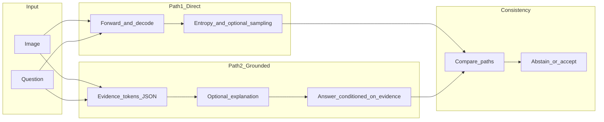

# Medical Visual Question Answering (MedVQA)

Einheitliches Framework für Training und Evaluation von **LLaVA**- und **LLaVA-Med**-Modellen auf den Medical-VQA-Datensätzen **PathVQA**, **SLAKE** und **VQA-Rad**.

Dieses Repository dient gleichzeitig als Codebasis für eine **Masterarbeit** zur **Unsicherheitskalibrierung** (selective prediction, Risk-Coverage, AURC) und zum **visuellen Grounding** über ein geplantes **Dual-Path-Inferenzsystem**: ein Pfad für direkte Antworten inkl. Unsicherheitssignalen, ein zweiter für strukturiertes, evidenzbasiertes Reasoning.

---

## Inhaltsverzeichnis

- [Kurzüberblick Masterarbeit](#kurzüberblick-masterarbeit)
- [Ist-Zustand vs. Blueprint (Roadmap)](#ist-zustand-vs-blueprint-roadmap)
- [Geplante Systemarchitektur](#geplante-systemarchitektur)
- [Repository-Layout](#repository-layout)
- [Installation & Setup](#installation--setup)
- [Schritt 1: Daten](#schritt-1-daten)
- [Schritt 2: Training (Baseline)](#schritt-2-training-baseline)
- [Schritt 3: Inferenz Path 1 (Unsicherheit)](#schritt-3-inferenz-path-1-unsicherheit)
- [Schritt 4: Inferenz Path 2 (Grounding, geplant)](#schritt-4-inferenz-path-2-grounding-geplant)
- [Schritt 5: Konsistenz & Abstain (geplant)](#schritt-5-konsistenz--abstain-geplant)
- [Schritt 6: Evaluation](#schritt-6-evaluation)
- [Schritt 7: Experimente & Ablations](#schritt-7-experimente--ablations)
- [Ergebnisse & Artefakte](#ergebnisse--artefakte)
- [Data Loader (API)](#data-loader-api)
- [Debugging & Qualitätssicherung](#debugging--qualitätssicherung)
- [Troubleshooting](#troubleshooting)

---

## Kurzüberblick Masterarbeit

**Ziele:**

- **Kalibrierung / Zuverlässigkeit:** Unsicherheitsmaß primär über tokenbasierte Entropie, selektive Vorhersage mit Schwellen \( \tau \), Kurven **Risk–Coverage** und **AURC** (Area Under the Risk–Coverage Curve).
- **Grounding:** Strukturierte **Evidence-Tokens** (z. B. Organ, Region, Merkmal; in Pathologie zusätzlich tissue type, cellular pattern, staining/morphology), optional ROI-Unterstützung (SAM, Attention, Crop/Visual Prompt), Evaluierung u. a. über **kontrafaktische** Eingaben (blank, patch-permutation, definierte ROI-Maskierung).
- **Dual-Path:** Pfad 1 (direkt) und Pfad 2 (grounded) mit **Konsistenzlogik** und **Abstain**, wenn Unsicherheit hoch und die Pfade widersprechen.

**Datensätze:** PathVQA, SLAKE, VQA-Rad, Med-VQA-2019 (siehe unten).

**Optional Stage-1 (extern):** Das Paper/Dataset **S-Chain** (*Structured Visual Chain-of-Thought*) liefert expertisch annotierte **SV-CoT**-Spuren mit Bounding Boxes (u. a. OASIS-MRI). Ein Pretraining oder eine Adapter-Stage darauf ist **inhaltlich** naheliegend, aber **domänenverschieden** zu Rad/Pathologie in den drei Zieldatensätzen; ein etwaiger Transfer ist eine **eigene empirische Fragestellung**, nicht „out of the box“ dieselbe Verteilung.

---

## Ist-Zustand vs. Blueprint (Roadmap)

| Komponente | Status im Repository |
|------------|----------------------|
| Einheitlicher Datenloader (`MedicalVQALoader`, `VQASample`) | **Implementiert** (`utils/load_data.py`) |
| Training Standard-LLaVA (HF `LlavaForConditionalGeneration` + `Trainer`) | **Implementiert** (`train.py`) |
| Training LLaVA-Med (Microsoft-`llava` + `Trainer`) | **Implementiert** (`train_med.py`, benötigt installiertes LLaVA-Med) |
| Inferenz LLaVA + Unsicherheitsmetriken (`entropy`, `agreement`, `confidence`) | **Implementiert** (`inference.py`) |
| Inferenz LLaVA-Med | **Implementiert** (`inference_med.py`) |
| Metriken auf Ergebnis-JSON (Accuracy-Gruppen, BLEU, ROUGE-L, BERTScore, mittlere Token-Entropie) | **Implementiert** (`evaluate.py`) |
| Risk–Coverage-Sweep, AURC, Plots | **Implementiert** (`risk_coverage_entropy.py`) |
| Selector / MLP-Workflow (LLaVA-Med-Features) | **Implementiert** (`selector_multimodal.py`) |
| **5-fach Sampling + Agreement** | **Implementiert** (`inference.py`, `inference_med.py`) |
| **Pfad 2: Evidence-JSON, konditionierte finale Antwort** | **Geplant** |
| **ROI-Pipeline mit Ablations-Toggle** (SAM/Attention, Crop/Overlay) | **Geplant** |
| **Dual-Path-Konsistenz & Abstain-Regeln** | **Geplant** |
| **ECE** (Binning-Kalibrierung), feste Risk-/Coverage-Ziele als eigene Pipeline | **Geplant** (AURC/Coverage-Abschnitte existieren in `risk_coverage_entropy.py`) |
| **Kontrafaktische Grounding-Eval** (blank/shuffled/ROI-masked) | **Geplant** |
| Modulstruktur `data/`, `models/`, `inference/`, `uncertainty/`, … | **Roadmap** (aktuell Skripte im Root + `utils/`) |

---

## Geplante Systemarchitektur

Ablauf gemäß Implementation Blueprint (Zielbild):



- **Path 1:** Standard-VQA-Generierung; Unsicherheit aus **einer** Greedy- oder Sample-Pass-Generierung (aktuell: Entropie aus `output_scores`); geplant zusätzlich **N Stichproben** (empfohlen \(N=5\) bis \(10\), mit `temperature`/`top_p`) und **Agreement** zwischen Antwortstrings als zentrale Erweiterung.
- **Path 2:** Separater Ablauf (eigener Prompt / eigene Vorwärtsläufe): strukturierte Evidence-Ausgabe, optional kurze Begründung, dann finale Antwort; **nicht** mit Path 1 vermischen, bis die Fusion in der Konsistenzschicht erfolgt.
- **ROI (optional):** Vorverarbeitung oder Visual Prompt; per Flag ein-/ausschaltbar für Ablationsstudien.

---

## Repository-Layout

**Aktuell (ausgewählt):**

| Pfad | Rolle |
|------|--------|
| `train.py` | Fine-Tuning **HuggingFace LLaVA 1.5** |
| `train_med.py` | Fine-Tuning **LLaVA-Med** (Microsoft-Codebasis) |
| `inference.py` | Inferenz + Entropie (**LLaVA**) |
| `inference_med.py` | Inferenz (**LLaVA-Med**) |
| `evaluate.py` | Aggregierte Metriken aus JSON |
| `risk_coverage_entropy.py` | Entropie-Schwellen, Risk–Coverage, **AURC** |
| `selector_multimodal.py` | Feature-Extraktion, Selector-Training, Eval |
| `plot_entropy.py` | Hilfen zur Entropie-Visualisierung |
| `download_datasets.py` | Download PathVQA / SLAKE / VQA-Rad / Med-VQA-2019 nach `data/` |
| `example_loader_usage.py` | Beispiel Nutzung des Loaders |
| `utils/load_data.py` | `MedicalVQALoader`, `VQASample` |
| `utils/save_results.py` | JSON/CSV/XLSX + `results_history.csv` |
| `utils/prompt_formatter.py`, `utils/dataset.py` | Hilfsfunktionen |

**Optional (Blueprint):** spätere Paketstruktur `data/`, `models/`, `inference/`, `uncertainty/`, `grounding/`, `evaluation/`, `experiments/` – derzeit nicht als Verzeichnisse angelegt.

---

## Installation & Setup

- **Python** 3.10+ und **CUDA**-fähige GPU werden für Training und 7B-Inferenz empfohlen.
- **HuggingFace:** Erster Modell-Download braucht Netzwerkzugriff; Cache typisch unter `~/.cache/huggingface/hub/`.

### Abhängigkeiten (Kern + tatsächlich genutzte Pakete)

```bash
pip install torch transformers pillow pandas tqdm nltk wandb matplotlib numpy

# Für evaluate.py / save_results (Textmetriken)
pip install rouge-score bert-score

# Optional: XLSX-Export der Inferenz (utils/save_results.py)
pip install openpyxl

# Optional: Datensatz-Download (download_datasets.py)
pip install datasets huggingface_hub
```

**NLTK** (für BLEU in `evaluate.py`):

```python
import nltk
nltk.download("punkt")
```

**LLaVA-Med** (`train_med.py`, `inference_med.py`): gemäß Kommentar in `train_med.py` das Original-Repository installieren, z. B.:

```bash
cd LLaVA-Med && pip install -e .
```

---

## Schritt 1: Daten

### Erwartete Layouts (relativ zu `--data_root`, Standard: `data`)

Die Loader-Pfade nutzen die **kanonischen** Ordnernamen **`PathVQA`**, **`SLAKE`**, **`VQA-Rad`**, **`Med-VQA-2019`** (Groß-/Kleinschreibung wie in `utils/load_data.py`).

**PathVQA**

- `data/PathVQA/pathvqa_annotations/`: `pathvqa_train.csv`, `pathvqa_validation.csv`, `pathvqa_test.csv`
- `data/PathVQA/pathvqa_images/`: Bilder
- CSV-Spalten u. a.: `image_path`, `question`, `answer`

**SLAKE**

- `data/SLAKE/slake_annotations/`: `train.json`, **`validate.json`**, `test.json` (nicht `validation`)
- `data/SLAKE/slake_images/`: Bilder (z. B. Unterordner pro Fall)

**VQA-Rad**

- `data/VQA-Rad/vqarad_annotations/`: `vqarad_train.csv`, `vqarad_test.csv` (kein separates Validation-Split im Loader)
- `data/VQA-Rad/vqarad_images/`: Bilder

**Med-VQA-2019**

- `data/Med-VQA-2019/medvqa2019_annotations/`: `medvqa2019_train.csv`, `medvqa2019_validation.csv`, `medvqa2019_test.csv`
- `data/Med-VQA-2019/medvqa2019_images/`: Bilder
- Downloadquelle in `download_datasets.py`: HuggingFace `claudioreeves/imageclef-vqa-med-2019`

### Download

```bash
python download_datasets.py
```

Voraussetzungen siehe Kopfkommentar in `download_datasets.py` (`datasets`, `huggingface_hub`, …).

---

## Schritt 2: Training (Baseline)

### Prompt- und Loss-Format (Standard-LLaVA, `train.py`)

Entspricht den Kommentaren im Code:

- **Konversation:** Nutzer-Inhalt = Bild + Text (Frage + kurze medizinische Instruction), Assistent = **nur die Antwort**.
- **Training:** Der Loss wird **nur auf den Tokens der Assistenten-Antwort** berechnet (Prompt-Teil mit `-100` maskiert).

### Standard-LLaVA trainieren

```bash
python train.py \
  --dataset pathvqa \
  --output_dir ./outputs/llava_pathvqa
```

Beispiel Med-VQA-2019:

```bash
python train.py \
  --dataset medvqa2019 \
  --output_dir ./outputs/llava_medvqa2019
```

Default `--model_path`: `llava-hf/llava-1.5-7b-hf`.

Fortsetzung von Checkpoint:

```bash
python train.py \
  --model_path ./outputs/llava_pathvqa \
  --dataset slake \
  --output_dir ./outputs/llava_slake
```

Wichtige Optionen (Auszug): `--data_root`, `--train_split`, `--val_split` (bei SLAKE Validation z. B. `--val_split validate`), `--num_train_epochs`, `--per_device_train_batch_size`, `--learning_rate`, `--max_length`, `--fp16` / `--bf16`, `--gradient_checkpointing`, LoRA-Flags (`--use_lora`, …), `--wandb_project`.

**Hinweis:** `train.py` ist **nur** für HuggingFace-LLaVA. **LLaVA-Med** läuft über `train_med.py` (Default `microsoft/llava-med-v1.5-mistral-7b`).

### Stufen-Strategie (Thesis / Blueprint)

1. **Grounding-Pretraining (optional, extern):** Stage auf **S-Chain**-artigem SV-CoT-Material als Grounding-Vortraining (Domain-Shift beachten).
2. **In-domain Grounding:** **SLAKE** mit oder ohne ROI (ROI: geplant), da SLAKE näher am geplanten Grounding-Setup liegt.
3. **Weak-grounding Transfer:** **VQA-Rad / PathVQA** mit derselben Pipeline als Transfer-/Robustheitsprüfung (weniger explizites Grounding als S-Chain/SLAKE).

**Optional:** Zusätzlicher Loss auf **Evidence-/Zwischentokens** (nur sinnvoll mit supervisierten oder distillierten Labels).

---

## Schritt 3: Inferenz Path 1 (Unsicherheit)

### Ablauf (Zielbild Blueprint)

1. Bild + Frage
2. Vorwärts-Generierung (greedy oder sampling)
3. \(N\) unabhängige Samples (Default: **5**) bei `temperature > 0` für Agreement-Berechnung
4. Agreement über die \(N\) decodierten Buchstaben als zusätzlicher Unsicherheits-/Stabilitätsindikator

### Ist-Zustand (`inference.py`)

- Hauptlauf mit `model.generate(..., output_scores=True)` pro Beispiel für Antwort, Entropie und Confidence.
- **Entropie (aktueller Stand):** Pro Beispiel werden `--agreement_samples` stochastische Läufe durchgeführt; `entropy` ist der Mittelwert der laufweisen Entropie-Mittelwerte. `entropy_tokens` bleibt als tokenweise Entropie aus dem Hauptlauf gespeichert.
- **Wichtige Präzisierung:** Diese Aggregation ist methodisch nur eine Übergangslösung. Zieldefinition ist token-distributionsbasiert über **alle** generierten Positionen ohne Unique-Filter, z. B. \(H = -\sum_t p(y_t)\log p(y_t)\) bzw. eine äquivalente positionsweise Aggregation.
- **Agreement-Sampling:** Zusätzlich werden standardmäßig `--agreement_samples 5` stochastische Läufe ausgeführt (mit `temperature`/`top_p`) und als Mehrheitsanteil aggregiert.
- **Confidence:** `confidence` wird als Mittelwert der laufweisen Top-1-Tokenwahrscheinlichkeiten über alle Agreement-Samples gespeichert.

### Aufruf (Beispiele)

```bash
python inference.py \
  --dataset pathvqa \
  --split test \
  --results_dir results
```

Mit fine-getunten Gewichten (Weg zum Checkpoint anpassen):

```bash
python inference.py \
  --model_path ./outputs/llava_pathvqa \
  --dataset pathvqa \
  --split test \
  --finetuned \
  --results_dir results
```

Stichprobige Decodierung (für spätere Sampling-Erweiterungen relevant):

```bash
python inference.py \
  --dataset slake \
  --split test \
  --do_sample \
  --temperature 0.7 \
  --top_p 0.9 \
  --results_dir results
```

Med-VQA-2019 (Test-Split):

```bash
python inference.py \
  --dataset medvqa2019 \
  --split test \
  --results_dir results
```

Weitere Flags: `--data_root`, `--max_new_tokens`, `--num_beams`, `--agreement_samples`, `--ablation_mode`, `--ablation_seed`, `--n_samples` (nur erste \(N\) Datensatzzeilen), W&B (`--wandb_project`, `--wandb_run_name`).

### Counterfactual Ablation-Modi (`inference.py`, `inference_med.py`)

Für kontrollierte Gegenfaktual-Tests kann ein globaler Ablationsmodus gesetzt werden:

- `--ablation_mode none`: Standard, Originalbild pro Sample
- `--ablation_mode black`: Bild wird vollständig geschwärzt (gleiche Auflösung)
- `--ablation_mode shuffle`: Bildzuordnung wird pro Run zufällig zwischen Samples permutiert (Frage/GT bleiben beim Originalsample)

Optional steuert `--ablation_seed` die reproduzierbare Permutation im `shuffle`-Modus.

Beispiel (`black`):

```bash
python inference_med.py \
  --dataset vqarad \
  --split test \
  --ablation_mode black \
  --results_dir results
```

Beispiel (`shuffle`):

```bash
python inference.py \
  --dataset vqarad \
  --split test \
  --ablation_mode shuffle \
  --ablation_seed 42 \
  --results_dir results
```

### Ausgabe-Dateien

`utils/save_results.save_results` schreibt unter `--results_dir` u. a.:

- **`{modell_kurz}_{dataset}_{n_tag}.json`** – Liste von Dicts pro Sample
- Dieselbe Basis für `.csv` und optional `.xlsx`

`n_tag` ist `all`, wenn `--n_samples` nicht gesetzt ist.

### JSON-Felder pro Sample (mindestens)

- `image_path`, `source_image_path`, `ablation_mode`, `question`, `ground_truth_answer`, `predicted_answer`
- `entropy`, `entropy_tokens`, `agreement`, `agreement_samples`, `confidence`
- nach Inferenz ergänzt: `bleu_1` … `bleu_4`, `rougeL`, `bert_f1` (und weitere ROUGE-Keys je nach Version)

Das alte README-Beispiel mit `full_response` und `<question>`-Tokens ist **veraltet**; das tatsächliche Format folgt dem Chat-Template des Processors und den Feldern oben.

**LLaVA-Med:** `inference_med.py` (andere Konversationsschablone, siehe Dateikopf).

### MedSAM-ROI-Varianten (Overlay/Crop) für direkten Vergleich

Für den schnellen Vergleich **Originalbild vs. ROI-Bild** (ohne Trainingsänderung) kann `generate_medsam_roi_variants.py` genutzt werden.

Voraussetzung: installierte SAM/MedSAM-Abhängigkeiten (u. a. `segment_anything`) und ein passender Checkpoint (`--sam_checkpoint`).

Smoke-Test auf kleinen Teilmengen:

```bash
python generate_medsam_roi_variants.py \
  --data_root data \
  --datasets pathvqa vqarad \
  --splits test \
  --variants overlay crop \
  --sam_checkpoint /path/to/medsam_vit_b.pth \
  --sam_model_type vit_b \
  --output_root data_roi \
  --save_index_json \
  --n_samples 50
```

Voller Lauf für beide Test-Splits:

```bash
python generate_medsam_roi_variants.py \
  --data_root data \
  --datasets pathvqa vqarad \
  --splits test \
  --variants overlay crop \
  --sam_checkpoint /path/to/medsam_vit_b.pth \
  --sam_model_type vit_b \
  --output_root data_roi \
  --crop_margin_ratio 0.10 \
  --overlay_alpha 0.35 \
  --save_index_json
```

Ergebnisse liegen unter `data_roi/{dataset}/{split}/{variant}/...`, plus Index-Dateien in `data_roi/index/` (inkl. `bbox_xyxy`, `mask_area_ratio`, `variant_paths`, Status).

### Minimalmodus: Question-Guided Ranked ROI (VQA-Rad, Overlay)

Für einen schnellen Test des question-guided Rankings (Regelparser + Ranking über `predicted_iou`, Flächenprior, Zentrumsprior):

```bash
python generate_medsam_roi_variants.py \
  --data_root data \
  --datasets vqarad \
  --splits test \
  --variants overlay \
  --sam_checkpoint /path/to/sam_vit_b_01ec64.pth \
  --sam_model_type vit_b \
  --output_root data_roi \
  --save_index_json \
  --max_rois 50 \
  --min_mask_area_ratio 0.0 \
  --n_samples 50
```

Empfohlene Smoke-Validierung:

- `successful` klar höher als im Auto-Baseline-Lauf.
- In `data_roi/index/vqarad_test_roi_index.json` sind pro Sample zusätzlich `roi_rank_score`, `roi_ranking_components`, `guidance_mode` gesetzt.
- Stichprobe von Overlays zeigt weniger reine Rand-/Noise-Masken.

---

## Schritt 4: Inferenz Path 2 (Grounding, geplant)

**Spezifikation (Blueprint):**

1. Prompt zur Extraktion von **Evidence** im strukturierten Format, z. B. JSON-ähnlich: `{ "organ": "...", "region": "...", "feature": "...", "tissue_type": "...", "cellular_pattern": "...", "staining_or_morphology": "..." }` (konkrete Schlüssel und Pflichtfelder in der Arbeit festlegen; radiologie- und pathologie-tauglich halten).
2. Optional: kurze textliche Erklärung (nur Analyse oder auch Eingabe für Schritt 3).
3. Finale Antwort **bedingt** auf die Evidence-Tokens (separater Generate-Lauf).
4. Alle Artefakte **getrennt** von Path 1 speichern (eigene JSON-Spalten oder eigenes File-Set).

**ROI (optional, Ablations-Toggle):**

- Quelle: z. B. SAM / MedSAM / Attention-Maps → Bounding Boxes oder Masken.
- Einspielung: Crop, zusätzliches Bild, oder **Visual Prompt** (Box-Overlay im Sinne von S-Chain-Diskussionen zu „visual prompting“).
- In Experimenten: **mit ROI / ohne ROI** vergleichen.
- **Wichtiger Hinweis:** Pseudo-ROIs sind potentiell verrauscht und können Performance verschlechtern; Effekt immer mit Ablationen validieren.

### Vokabular: lokalisierbare Tokens (Reasoning / NER-Vorbereitung)

Skript [`build_vocab_localizable_openai.py`](build_vocab_localizable_openai.py): eindeutiges **Trainings**-Vokabular aus **SLAKE + VQA-Rad + Med-VQA-2019** (Freitext über `MedicalVQALoader(..., mc_data_root=None)`), englische **Stopwords** (NLTK mit Fallback; optional `--extra_stopwords_file`), danach **OpenAI**-Batch-Klassifikation, ob ein Token in typischen medizinischen Bildern **visuell lokalisierbar** ist. Artefakte: `vocab_localizable_train.json`, `vocab_localizable_train.csv`, Cache `openai_localizable_cache.jsonl` unter `--output_dir` (Default `results/reasoning_vocab/`).

Abhängigkeiten: `pip install openai python-dotenv nltk` (NLTK lädt `stopwords` bei Bedarf nach).

```bash
export OPENAI_API_KEY="..."
python build_vocab_localizable_openai.py \
  --data_root data \
  --output_dir results/reasoning_vocab \
  --batch_size 30 \
  --resume

# Kurztest ohne volles Vokabular:
python build_vocab_localizable_openai.py --data_root data --n_tokens 50
```

---

## Schritt 5: Konsistenz & Abstain (geplant)

**Richtlinien aus dem Blueprint:**

- **Pfad 1** und **Pfad 2** final vergleichen (normalisierte Strings oder semantische Ähnlichkeit – in der Arbeit definieren).
- **Widerspruch** und **hohe Unsicherheit** (Path 1) → **Abstain** (keine feste Antwort oder explizites „reject“).
- **Übereinstimmung** und **niedrige Unsicherheit** → Antwort **akzeptieren** (welcher Pfad „offiziell“ ausgegeben wird: z. B. Path 1 oder Path 2 oder Union-Regel – festlegen).

Beispielhafte Konsistenzregel:

```python
if match(path1_answer, path2_answer) and confidence > tau:
    decision = "accept"
elif (not match(path1_answer, path2_answer)) and confidence < tau_high:
    decision = "abstain"
else:
    decision = "fallback_path1"
```

Kein zusätzlicher harter Trainingsconstraint nötig; Fusion primär **inferenzzeitlich**.

**Offene Designparameter:** Schwellen für „hoch/niedrig“ (global, pro Datensatz, oder kalibriert auf Validierung); Match-Definition (normalisierter String-Match vs. semantischer Match); Definition der Unsicherheit/Konfidenz (nur Entropie vs. kombiniert mit Agreement).

---

## Schritt 6: Evaluation

### Standard-Metriken (`evaluate.py`)

```bash
python evaluate.py \
  --results_file results/llava_pathvqa_all.json \
  --output_file metrics_pathvqa.json
# output enthält MC-Kennzahlen (closed/open/overall auf Buchstaben)
```

Berichtet u. a. Accuracy (gesamt, Yes/No vs. offen wo anwendbar), **BLEU-1/4**, **ROUGE-L**, **BERTScore-F1**, Mittelwert der **tokenbasierten Entropie**, sowie Mittelwerte für **agreement** und **confidence** aus den Ergebniszeilen. Hängt an `ground_truth_answer` und `predicted_answer`.

Optional: `--eval_runs_file` (Standard `results/eval_runs.csv`) – eine Zeile pro Lauf.

**Zusätzliche Pakete:** `rouge-score`, `bert-score` (siehe Installation).

### Risk–Coverage & AURC (`risk_coverage_entropy.py`)

Erwartet eine **JSON-Liste** wie von `inference.py`, mit numerischem Score-Feld für Schwellenbildung (`entropy`, `agreement` oder `confidence`) und Ground Truth für die gewählte Risk-Metrik.

```bash
python risk_coverage_entropy.py \
  --results_file results/llava_pathvqa_all.json \
  --output_dir results \
  --score_field entropy \
  --risk_metric match \
  --num_thresholds 200
```

- **`--risk_metric`:** `match` (1 − Exact Match pro Zeile), oder `bleu1`, `bleu4`, `rouge`, `bertscore` (nutzt gespeicherte Felder pro Sample).
- **`--score_field`:** `entropy` (niedriger = sicherer), `agreement` oder `confidence` (höher = sicherer).
- Ausgaben: `*_risk_coverage.csv`, `*_risk_coverage_curve.png`, `*_risk_coverage_summary.json` (enthält **AURC**, Coverage bei Ziel-Risk, Risk bei Ziel-Coverage).

**Logik:** Bei `entropy` werden Samples mit **kleiner/gleich Schwelle** beantwortet; bei `agreement`/`confidence` mit **größer/gleich Schwelle**.

### Geplant: ECE & erweiterte Kalibrierung

- **ECE:** z. B. Zuverlässigkeitsdiagramm für eine aus Path 1 abgeleitete **Konfidenz** (Binning) gegen empirische Genauigkeit – derzeit **nicht** im Repo; dokumentieren als geplante Erweiterung neben AURC.

### Geplant: Grounding-Eval

Kontrafaktische Varianten derselben Frage:

- **Blank / Konstantbild**
- **Shuffled:** explizite **Patch-Permutation** (fixe Patchgröße und Permutationsschema pro Experiment dokumentieren)
- **ROI-maskiert:** explizit als **Zero-Mask**, **Blur-Mask** oder **Inpainting** definieren und konsistent verwenden

Metriken: Abfall von **Accuracy** und von **Konfidenz/Entropie** relativ zum Originalbild.

---

## Schritt 7: Experimente & Ablations

Empfohlene Matrix (aus Blueprint, an die Arbeit anpassen):

| Setting | Beschreibung |
|---------|----------------|
| Baseline | Ein Pfad, greedy oder festes Decoding, ohne ROI |
| + Evidence Tokens | Path 2 oder train-time Supervision auf Evidence |
| + Pseudo-ROI | ROI aus SAM/Attention vs. ohne ROI |
| + Dual Path | Path 1 + Path 2 + Fusion |
| + Agreement-based uncertainty | \(N\) Samples, Agreement + Entropie |
| + Counterfactual training | optional Training mit kontrafaktischen Paaren |

Für jede Zeile: gleiche Test-Splits, gespeicherte JSONs mit Scores, AURC/Vergleich der Kurven, qualitative Grounding-Beispiele.

Terminologie (für die Arbeit konsistent halten):
- **uncertainty** = Entropie-basiertes Unsicherheitsmaß
- **confidence** = kombinierter Score (z. B. aus Agreement + Entropie)

---

## Ergebnisse & Artefakte

- **Checkpoints:** `--output_dir` aus `train.py` / `train_med.py`
- **Inferenz:** `results/*.json`, `.csv`, optional `.xlsx`, `results_history.csv`
- **Eval:** `metrics*.json`, `eval_runs.csv`
- **Selektive Vorhersage:** `risk_coverage_entropy.py`-Outputs (CSV, PNG, Summary-JSON)
- **Thesis:** Kurven, Tabellen, ausgewählte Fehlerfälle und Grounding-Visualisierungen

---

## Data Loader (API)

```python
from utils.load_data import MedicalVQALoader

loader = MedicalVQALoader(data_root="data")
samples = loader.load_dataset("pathvqa", split="train")
samples_slake = loader.load_dataset("slake", split="validate")
samples_rad = loader.load_dataset("vqarad", split="test")
samples_medvqa = loader.load_dataset("medvqa2019", split="test")

print(loader.get_available_datasets())
print(loader.get_available_splits("slake"))  # u. a. validate
```

Jedes Element ist ein **`VQASample`:** `dataset`, `split`, `image_path`, `question`, `answer` (bei MC: Zielbuchstabe), `metadata`, `mc_options`, `mc_correct_index`, `question_type`.

`loader.load_combined("train")` kombiniert PathVQA, SLAKE, VQA-Rad und Med-VQA-2019.

---

## Multiple-Choice-Datensätze mit OpenAI

Mit `build_mc_datasets_openai.py` können MC-Varianten für `pathvqa`, `slake`, `vqarad`, `medvqa2019` erzeugt werden:

- **Closed/Yes-No** (`answer` = `yes` oder `no`): Optionen strikt `["yes", "no"]`
- **Open**: 4 via OpenAI generierte falsche Optionen + GT (insgesamt 5)
- Neues Feld pro Sample: `question_type` (`closed` oder `open`)

Voraussetzung:

```bash
pip install openai
export OPENAI_API_KEY="..."
```

Smoke-Test:

```bash
python build_mc_datasets_openai.py \
  --data_root data \
  --output_root data_mc_openai \
  --datasets pathvqa slake vqarad medvqa2019 \
  --openai_model gpt-4o-mini \
  --n_samples 100 \
  --save_every 20
```

Fortsetzbarer Lauf (Resume):

```bash
python build_mc_datasets_openai.py \
  --data_root data \
  --output_root data_mc_openai \
  --datasets pathvqa slake vqarad medvqa2019 \
  --openai_model gpt-4o-mini \
  --resume
```

Ausgabe pro Datensatz:


**MC als Standardpfad:** `MedicalVQALoader` lädt standardmäßig aus `data_mc_openai`.
Wenn die MC-Dateien fehlen, wird ein Fehler mit Verweis auf `build_mc_datasets_openai.py` ausgegeben.
Legacy-Freitext ist optional über `mc_data_root=None` möglich.

- `<output_root>/<dataset>/<dataset>_<split>_mc_openai.json`
- `<output_root>/<dataset>/<dataset>_<split>_mc_openai.csv`
- Cache für Distraktoren: `<output_root>/<dataset>/openai_distractor_cache.jsonl`

---

## Debugging & Qualitätssicherung

- Korrelation **Agreement** (wenn implementiert) vs. **Korrektheit** auf Validierung.
- **ROI vs. Attention:** qualitative Plots (z. B. `plot_entropy.py` für Entropiestatistiken).
- **Failure Cases** manuell durchgehen (CSV/JSON filtern).
- Bei Sampling: ausreichende **Diversität** der \(N\) Antworten (Temperature/Top-p nicht zu niedrig).

---

## Troubleshooting

### Modell wird nicht gefunden

- HuggingFace-ID oder lokaler Pfad prüfen.
- Netzwerk für ersten Download; danach Cache nutzen.

### Dataset nicht gefunden

- `--data_root` und Ordnernamen **`PathVQA` / `SLAKE` / `VQA-Rad` / `Med-VQA-2019`** prüfen.
- SLAKE: Split **`validate`**, nicht `validation`.
- VQA-Rad: kein `validation`-Annotation-File im Standard-Layout.
- Med-VQA-2019: erwartet `medvqa2019_{train,validation,test}.csv` in `medvqa2019_annotations/`.

### Out of Memory

- `--per_device_train_batch_size` senken, `--gradient_accumulation_steps` erhöhen.
- `--fp16` oder `--bf16`, `--gradient_checkpointing` in `train.py`.

### Fehlende Metrik-Bibliotheken

- `evaluate.py` / `save_results.py`: `pip install rouge-score bert-score`.
- XLSX: `pip install openpyxl`.

---

## Workflow-Beispiel (Ende-zu-Ende)

```bash
# Training
python train.py \
  --dataset pathvqa \
  --data_root data \
  --mc_data_root data_mc_openai \
  --output_dir ./outputs/llava_pathvqa \
  --num_train_epochs 5 \
  --learning_rate 2e-5

# Inferenz
python inference.py \
  --model_path ./outputs/llava_pathvqa \
  --data_root data \
  --mc_data_root data_mc_openai \
  --dataset pathvqa \
  --split test \
  --max_new_tokens 8 \
  --finetuned \
  --results_dir results

# Metriken
python evaluate.py \
  --results_file results/llava_pathvqa_all.json \
  --output_file metrics_pathvqa.json
# output enthält MC-Kennzahlen (closed/open/overall auf Buchstaben)

# Risk–Coverage / AURC
python risk_coverage_entropy.py \
  --results_file results/llava_pathvqa_all.json \
  --output_dir results \
  --score_field entropy \
  --risk_metric match
```

Vergleich mit **Basis-Modell** (ohne Fine-Tuning): `--model_path` weglassen oder explizit `llava-hf/llava-1.5-7b-hf` setzen und gleiche Pipeline fahren.

---

## Modelle (Referenz)

| Modell | Standard-ID / Pfad |
|--------|---------------------|
| LLaVA 1.5 (7B, HF) | `llava-hf/llava-1.5-7b-hf` |
| LLaVA-Med | `microsoft/llava-med-v1.5-mistral-7b` |

Fine-getunte Gewichte liegen unter dem gewählten `--output_dir` und können in `inference.py` / `train.py` via `--model_path` weiterverwendet werden.
